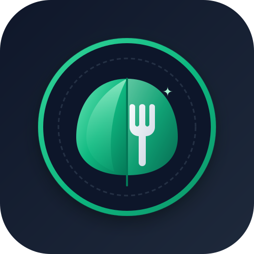

<h1>GreenPlate</h1>
<p><strong>Vegetarian recipe discovery, fridge matching, and PDF cookbook generation</strong></p>

---

## 👀 Overview

GreenPlate is a responsive web application for discovering and organizing vegetarian recipes. It features a secure serverless backend proxy with feature-specific rate limits for vegetarian recipe search (`VegSearch`) and ingredient matching (`MyFridge`), real-time autocomplete, offline cache resilience, and client-side PDF cookbook generation.

---

## ⚡ Key Features

### Recipe Discovery (VegSearch)

- Search vegetarian recipes safely via a serverless proxy protecting the Spoonacular API key
- Receive live search suggestions through input-sanitized autocomplete
- Browse recipe images, detailed ingredients, and step-by-step preparation instructions
- View expanded recipe details with strict parameter validation

### Fridge Matcher (MyFridge)

- Enter ingredients currently available at home to discover matching recipes
- Compare ingredient matches against missing ingredients
- Sort results dynamically by match relevance

### Favorites & Offline Resilience

- Save recipes across sessions using browser `localStorage`
- Two-tier quota protection combining fail-closed server-side rate limiting (Upstash Redis) with feature-specific limits (6 queries/day for VegSearch, 4 queries/day for MyFridge) and client-side fallback
- Filter cached recipes while offline or when daily API quotas are exhausted
- Create custom cookbooks from saved favorites

### PDF Cookbook Generator

- Export individual recipes to formatted PDF documents
- Combine up to 30 favorite recipes into a single custom cookbook
- Automatically format recipe titles, ingredients, and preparation steps
- Multi-page document layout generated client-side with jsPDF

---

## 🛠 Tech Stack

- **Frontend:** React 18, JavaScript (ES6+), HTML5, CSS3
- **Build Tool:** Vite
- **HTTP Client:** Axios
- **Serverless Backend:** Vercel Serverless Functions (`api/spoonacular.js`) with strict whitelist validation and parameter sanitization
- **Rate Limiting / Quota Enforcement:** Upstash Redis (REST API) with fail-closed protection (global & per-feature IP limits)
- **Recipe Data API:** Spoonacular API
- **PDF Generation:** jsPDF
- **Local Persistence:** Browser `localStorage`
- **Testing:** Vitest
- **Deployment:** Vercel

---

## 💻 Getting Started

Get GreenPlate running locally in just a few minutes.

### Prerequisites

Make sure the following are installed and configured:

- [Node.js](https://nodejs.org/) (v18 or later)
- [npm](https://www.npmjs.com/)
- [Vercel CLI](https://vercel.com/docs/cli) (`npm install -g vercel`)
- An [Upstash Redis](https://upstash.com/) database instance (required for rate limiting)

### Installation

Clone the repository and install dependencies:

```bash
git clone [https://github.com/YOUR_USERNAME/greenplate.git](https://github.com/YOUR_USERNAME/greenplate.git)
cd greenplate
npm install
```

### Environment Variables

Copy .env.example to .env.local in the project root and fill in your keys:

```env
SPOONACULAR_API_KEY=your_spoonacular_api_key
UPSTASH_REDIS_REST_URL=https://your-database.upstash.io
UPSTASH_REDIS_REST_TOKEN=your_upstash_rest_token
```
🔒 Security Note: Redis keys are mandatory. The serverless proxy operates on a fail-closed (no-go) security policy: incoming API requests return HTTP 500/503 if Redis credentials are missing or unreachable, ensuring the Spoonacular API key is never exposed or exploited without rate limits.

### Running the Application

#### Full-Stack Development (Recommended for Live Data)

Runs the React frontend alongside local Vercel serverless functions and Upstash Redis rate limiting.

```bash
npm run vercel:dev
```

Open the application at:

```text
http://localhost:3000
```

Recommended for testing:

- Live recipe search (VegSearch) and autocomplete
- Ingredient matching (MyFridge)
- Serverless API proxy and sanitization
- Redis rate limiting and quota enforcement
- End-to-end network flows and error handling

#### Frontend-Only Development (Offline / UI Mode)

Runs the Vite development server without proxy backend services.

```bash
npm run dev
```

Open the application at:

```text
http://localhost:5173
```

Note: In frontend-only mode, live API requests are bypassed. The application operates strictly via local localStorage cache, ideal for UI component tweaking, styling, and offline functionality testing.

### Available Scripts

```bash
npm run dev          # Start Vite development server (offline UI mode)
npm run vercel:dev   # Start local full-stack environment with Vercel CLI
npm run build        # Create production build
npm run preview      # Preview production build locally
npm run lint         # Run ESLint check
npm run test         # Run single-pass Vitest suite
npm run test:watch   # Run Vitest in interactive watch mode
```

---

## 📁 Project Architecture

```text
greenplate/
├── api/
│   └── spoonacular.js       # Serverless API proxy & Upstash quota limit
├── public/                  # Public assets and logo images
│   ├── flg-signature.svg
│   └── logo.svg
├── src/
│   ├── __mocks__/           # Mock data for testing
│   ├── api/                 # API communication layer
│   ├── components/          # Reusable interface components plus tests
│   ├── context/             # React Context providers
│   ├── hooks/               # Custom React hooks
│   ├── pages/               # Application page views
│   ├── styles/              # Global and component styles
│   ├── utils/               # Cache, quota, and PDF generator utilities
│   ├── App.jsx
│   ├── main.jsx
│   └── setupTests.jsx
├── .gitignore
├── eslint.config.js
├── index.html
├── package.json
└── vite.config.js
```

---

## 🎥 Live Demo

View the live application on [Vercel](https://flg-greenplate.vercel.app/).

---

## 🔐 License

This project is licensed under the MIT License. See the `LICENSE` file for details.

---

## 👨‍💻 Author

Developed with ❤️ by 


---

## ✨ Acknowledgements

- Spoonacular for recipe data
- Upstash Redis for serverless rate limiting
- jsPDF for client-side PDF generation
- React and Vite for the frontend development environment
- Vercel for deployment and serverless functions
